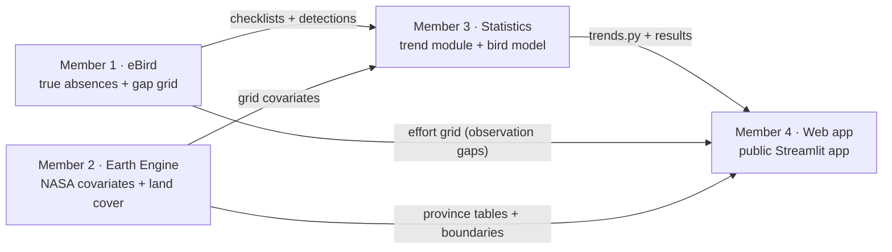

# AviTrend PH — Team Build Plan

Last updated: Nov 15, 2026 · Live version: https://claude.ai/artifact/NrXewXvqbkW2KDhVBStiEG

## Summary for the team (read this first)

We are building a public web app that answers the Challenge 2 question for the Philippines: **what is changing, where, by how much, and is it statistically significant?** Then it adds the part other teams won't have: **does that change matter for birds?**

**One-sentence pitch:** *NASA satellites show where night-time light, vegetation, heat and rain are changing across the Philippines, and real birdwatcher checklists show which bird species respond, starting with Greater Manila, where city light is spreading outward over Manila Bay, Bulacan, Cavite, Rizal and Laguna.*

**What the user sees**

1. **Trend Explorer (meets the challenge).** Pick a variable (night light, vegetation, land temperature, rain, land cover), a province and a time window. Watch a PAGASA-style monthly animation. Get a plain answer: "Increasing, +0.6 nW/cm²/sr per year, significant (p = 0.003)." A map shows which provinces changed significantly.
2. **Birds & Light (our addition).** For the Greater Manila focus area, see whether light-sensitive birds are reported less often where light increased, compared with light-tolerant birds. Areas with no birdwatchers are shown as **observation gaps**, never as zero birds.
3. **About the data.** Datasets, methods and honest limitations.

**Who does what**

| Member | Role | Delivers |
| --- | --- | --- |
| Member 1 | eBird data ingestion | Clean checklists with true absences and an observation-gap grid |
| Member 2 | Earth Engine covariates | Monthly NASA covariate tables for all provinces and for the 1 km focus grid |
| Member 3 | Statistics and modelling | A reusable trend-test module, plus the bird model results |
| Member 4 | Web app | The public Streamlit app that ties it all together |

**Core vs add-on.** Everything in the member sections is **core**: it must work before submission. Anything marked **\[ADD-ON\]** is only started after the core checks pass. Add-ons are collected in their own section near the end.

**Three rules everyone follows**

- **NASA data drives the analysis.** The four monthly covariates come from NASA products (Black Marble, MODIS NDVI, MODIS LST, GPM IMERG). Land cover is added as a fifth, yearly covariate (product to be confirmed by Member 2; it may be non-NASA, which is fine).
- **No observer is not the same as no birds.** A complete checklist that didn't report a species is a true absence (0). A place with no checklist is an observation gap (blank).
- **No circularity.** Gaps are never filled using the covariates and then fed into a significance test. Statistics use real checklists only.

*App name "AviTrend PH" is a placeholder. Rename freely.*

## Key decisions and ground rules

These are fixed so the four members can work in parallel without waiting on each other. Change one only by telling the whole team.

**Datasets (all NASA except where noted)**

| Variable | Product (Earth Engine ID) | Native resolution | Monthly value | Unit in our tables |
| --- | --- | --- | --- | --- |
| Night-time light (ALAN) | NASA Black Marble `NASA/VIIRS/002/VNP46A2`, band `DNB_BRDF_Corrected_NTL` | 500 m, daily | Median of good-quality days | nW/cm²/sr |
| Vegetation (NDVI) | MODIS `MODIS/061/MOD13A1`, band `NDVI` (× 0.0001) | 500 m, 16-day | Mean of composites starting in that month | unitless (−1 to 1) |
| Land surface temperature | MODIS `MODIS/061/MOD11A2`, band `LST_Day_1km` (× 0.02 − 273.15) | 1 km, 8-day | Mean | °C |
| Rain | GPM IMERG `NASA/GPM_L3/IMERG_MONTHLY_V07`, band `precipitation` | \~10 km, monthly | Rate × hours in month | mm/month |
| Land cover | **REMINDER for Member 2: confirm the exact Earth Engine ID used in the Avilight script.** Candidates: MODIS `MODIS/061/MCD12Q1` (NASA, band `LC_Type1`), ESA WorldCover, Google Dynamic World | depends on product (MCD12Q1: 500 m, yearly) | Yearly, as share of area per class group | fraction (0–1) |
| Bird checklists | eBird Basic Dataset + Sampling Event Data (Cornell Lab, not NASA) | point | see Member 1 | detected 0/1 |

Member 2 confirms each ID in the Earth Engine catalog on the first hour. If an ID differs (for example IMERG V06 vs V07), use the current one and tell the team.

**Space and time**

- **Time window:** January 2014 to December 2025, monthly (144 months).
- **Trend Explorer area:** the whole Philippines, by province (FAO GAUL level 2 in Earth Engine).
- **Bird focus area:** Greater Manila, latitude 14.00–15.30 N, longitude 120.50–121.60 E. It runs from the bright city core out to darker, fast-changing edges (Bulacan, Pampanga including the Candaba marsh, Rizal, Laguna, Cavite, east Bataan) and covers all of Manila Bay, including the Las Piñas–Parañaque wetlands. Why wider than the Avilight Metro box: the light effect needs dark-to-bright contrast and places where light actually grew, and this box roughly doubles the checklists (about 8,100 vs 4,500 complete checklists in 2025).
- **Focus grid:** about 1 km cells. Everyone computes the cell the same way, so no file needs to be shared to agree on it:

```
row = floor((lat - 14.00) / 0.009)
col = floor((lon - 120.50) / 0.009)
cell_id = f"{row:03d}_{col:03d}"
```

**Why monthly, not daily.** Daily satellite images over Manila are mostly cloud gaps, and daily eBird data per cell is nearly empty. Monthly gives 144 animation frames and valid statistics. Daily playback is listed as an add-on.

**Bird data vocabulary**

| Term | Meaning | Stored as |
| --- | --- | --- |
| Detection | A complete checklist reported the species | 1 |
| True absence (non-detection) | A complete checklist did **not** report the species | 0 |
| Observation gap | No complete checklist in that cell and month | no row; flagged in the effort grid |
| Low-data cell | Fewer than 5 checklists in that cell over the analysis period | shown outlined, excluded from maps of rates |

**Where each definition comes from.** A true absence is a **definition based on the eBird protocol**, not a statistical result: on a complete checklist the birder declares they reported every species they identified, so a missing species was looked for and not found (cite the eBird Best Practices guide). Incomplete checklists are dropped entirely: they count neither as absences nor as observations. **Keeping gaps blank is justified with Moran's I** (Member 3, part C): unobserved cells are spatially clustered, so missing data is not random, and filling gaps with zeros or imputing them would bias the results.

**Why 1 km cells, not 500 m.** eBird locations are a start point or hotspot pin, and traveling checklists cover kilometres, so 500 m claims more precision than the data has. 500 m would also mean about 4× the cells (about 71,000) with the same checklists, so most cells would become gaps; land temperature is only 1 km natively; and exports would be 4× larger. Satellite data is still **sampled at 500 m** and averaged into each 1 km cell, so an existing 500 m extraction script can be reused: average each 2×2 block of 500 m cells into one 1 km cell. Values extracted at checklist points with 500 m pixels are also fine for the bird model; the 1 km grid is then used for the gap map and the app.

**The no-circularity rule.** Significance tests and model coefficients use real checklists only. Nothing predicted from the covariates ever goes back into a test. A predicted map is allowed only as an add-on, labeled "Predicted, not observed".

**Files and naming**

- One shared GitHub repo (public at submission). Folders: `data/raw/` (not committed if large), `data/processed/`, `notebooks/`, `src/`, `app/`.
- Processed tables as **Parquet** (CSV acceptable if small). Column names in `snake_case`. Dates as `year` and `month` integer columns.
- Every dataset, library and code snippet you use goes into `REFERENCES.md` the moment you use it. The submission requires listing all of them.
- If you use an AI tool to write code or text, note it in `REFERENCES.md` under "AI assistance". The submission requires this too.

## Timeline and hand-offs

All four members start at the same time. Agreed file formats and mock data mean nobody waits on anyone else until integration.



Member 3 hands `trends.py` to Member 4 first, so the Trend Explorer works before any bird data exists. The bird model is the last piece because it needs both Member 1's and Member 2's files.

**Phases.** The deadline in the team brief is Sun Nov 15, 11:59 p.m. Fit the phases to the hours you actually have.

1. **Phase 0, first hour (everyone).** Create the repo. Member 1 requests or confirms the eBird 2014–2025 download with sampling data. Member 2 confirms dataset IDs and **starts the Earth Engine exports** (they can queue for hours). Member 3 writes `trends.py` on synthetic data. Member 4 writes the mock-data script and the app skeleton.
2. **Phase 1, parallel build.** Member 1 cleans and zero-fills. Member 2 cleans the exported tables. Member 3 finishes and tests `trends.py`, hands it to Member 4, and computes `province_trends`. Member 4 builds all three pages on mock data and deploys a first public version.
3. **Phase 2, integration.** Member 3 fits the bird model. Member 4 swaps in real data and redeploys. Run the integration test once.
4. **Phase 3, fix and extend.** Fix what the integration test found, then start add-ons in order. Final integration test before submission.

**Critical path and fallback.** The slowest chain is eBird download → cleaning → bird model → Birds page. If the 2014–2025 download is late, Member 1 builds the whole pipeline on the 2025–2026 files already in the folder (they include sampling data), and swaps in the full years when they arrive. The Trend Explorer doesn't depend on eBird at all, so the challenge requirement is safe either way.

## Member 1: eBird data ingestion and cleaning

**Status: done.** All checks pass; outputs are in `data/processed/` and the hand-off note has been sent to Member 3. Built with `notebooks/01_member1_ebird_yearly.ipynb`.

**Goal:** turn raw eBird files into checklists with true absences, plus a grid showing where nobody birded. Member 3 models from these files; Member 4 maps the effort grid.

**Inputs (as built)**

- **Yearly eBird observation files** (`2014_EBIRD` … `2025_EBIRD`, Google Sheets shared by link). They have no `SAMPLING EVENT IDENTIFIER`, so checklists are rebuilt (step 3).
- Species masterlist from Avilight (Google Sheet, shared by link): `Species Name`, `Light Tolerance`, `Migratory Status`.
- Alternative route (not used): the official eBird downloads with Sampling Event Data (`ebd_..._smp_....zip`) and `notebooks/01_member1_ebird_ingestion.ipynb`, which uses real checklist IDs. Use it if a full eBird download replaces the yearly files.

**How the notebook is run**

- **Part A, once per year:** set `YEAR` and `LINK`, load with `df = load_table(LINK)`, check columns, run `process_year(df, YEAR)`. Each year is saved to `data/interim/`.
- **Part B, once after all years:** combines the years inside the 2014–2025 window (other years, such as a partial 2026, are skipped), then builds the outputs and runs the checks.

**Steps (as built)**

1. **Check columns.** Required: `OBSERVATION DATE`, `LATITUDE`, `LONGITUDE`, `ALL SPECIES REPORTED`, `PROTOCOL NAME` (or `PROTOCOL TYPE`), `DURATION MINUTES`, `EFFORT DISTANCE KM`, `NUMBER OBSERVERS`, `COMMON NAME`, `OBSERVATION COUNT`. Without `ALL SPECIES REPORTED` or the effort columns, true absences and effort correction are impossible, so the notebook stops.
2. **Keep the year, approved records, and the Greater Manila box** (latitude 14.00–15.30, longitude 120.50–121.60). The notebook warns if a file covers a smaller area.
3. **Rebuild checklists.** Rows with the same date + start time + location (`LOCALITY ID`, else lat/lon to 4 decimals) + protocol + duration + distance + number of observers form one checklist, with a hashed `checklist_id`. Shared group checklists (copies of one outing) are identical on these columns, so they merge automatically; `GROUP IDENTIFIER` is used directly when present. A checklist counts as complete if any copy was complete. Validated against real eBird IDs on 2025: within 0.4%.
4. **Apply the eBird Best Practices filters:**
   - `ALL SPECIES REPORTED == 1` (complete checklists only; this is what makes a 0 a true absence)
   - Protocol is Stationary or Traveling
   - Duration 5–300 minutes
   - Distance ≤ 5 km (Stationary counts as 0 km). All are kept, with a `within_2km` flag: Member 3 fits the main bird model on ≤ 2 km checklists and uses ≤ 5 km as a robustness check
   - Number of observers 1–10
5. **Build detections.** Keep species-level records (`species`, `issf`, `form`, `domestic` count as their species; `spuh`, `slash` and `hybrid` are dropped). One row per checklist × species; for merged group copies the **highest** count is kept (not the sum). `X` counts: detection = 1, `count` left blank. **No median imputation.**
6. **Drop checklists with no bird records** (< 1%): a complete 5–300 minute checklist with zero birds is implausible here and most likely an entry error or withheld sensitive records.
7. **Add derived columns:** `year`, `month`, `week` (1–52), `hour_started` (decimal hours), `cell_row`, `cell_col`, `cell_id` (formula in Key decisions), `within_2km`.
8. **Species list and focus species.** Count detections per species and join masterlist traits by normalised name. `focus = True` when a species is detected on **at least 50 checklists and at least 1% of all checklists**, **and** has a known light tolerance. Common species without a trait are written to `species_unmatched.csv` for name fixes (it came out empty: all matched).
9. **Zero-fill (create the true absences).** Every usable checklist × every focus species: `detected = 1` if reported, else `0`. Duplicate checklist × species rows are merged before this step (a few occurred in 2020).
10. **Build the effort grid.** Every cell × year × month in 2014–2025, including empty ones: `n_checklists`, `total_hours`, `is_gap = n_checklists == 0`; per cell over the whole period, `low_data = 1–4 checklists`.

**Outputs (in `data/processed/`)**

| File | One row per | Columns | Result |
| --- | --- | --- | --- |
| `checklists.parquet` | usable checklist | `checklist_id, date, year, month, week, hour_started, protocol, duration_min, distance_km, within_2km, n_observers, lat, lon, cell_row, cell_col, cell_id` (+ locality columns if present) | 23,947 rows |
| `detections.parquet` | checklist × focus species | `checklist_id, species, detected, count` | 3,424,421 rows (143 focus species) |
| `species.parquet` | species | `species, scientific_name, n_detections, reporting_rate, light_tolerance, migratory_status, focus` | 364 species; focus 61 Sensitive / 82 Tolerant |
| `effort_grid.parquet` | cell × year × month | `cell_row, cell_col, cell_id, year, month, n_checklists, total_hours, is_gap, low_data` | 2,568,240 rows (17,835 × 144) |
| `filter_log.csv` | year × filter step | `year, step, checklists_remaining` | 2014–2025 |
| `species_unmatched.csv`, `figures/hotspots.png` | — | — | empty list; effort map 2014–2025 |

**Key facts for the team:** 88% of checklists are from 2020–2025 (2014: 111; 2025: 5,409); 87.8% are within 2 km; 1,459 cells have data and 434 have ≥ 5 checklists; Moran's I (provisional, before removing water cells): gaps 0.308, effort 0.226, both p ≤ 0.001. Full details in the hand-off note.

**Checks (all must pass before handing off)**

- [x] `checklist_id` is unique in `checklists.parquet`.
- [x] Rows in `detections.parquet` = (number of checklists) × (number of focus species), exactly.
- [x] Every `checklist_id` in detections exists in checklists.
- [x] Pick 3 species. Count checklists reporting each in the raw file after the same filters. It matches `detected.sum()` for that species.
- [x] No row has `ALL SPECIES REPORTED = 0`, duration > 300, distance > 5 or observers > 10.
- [x] Min/max lat and lon lie inside the focus box.
- [x] `filter_log.csv` shows checklists falling at each step, with no step losing over 90% (if it does, the filter is probably wrong).
- [x] Plot `n_checklists` per cell summed over all years. Known hotspots light up: La Mesa watershed / UP Diliman area, Rizal Park area, the Las Piñas–Parañaque wetlands, Candaba marsh, the Bataan coast and Mt. Makiling / Los Baños. Most other cells are gaps. Also check how many checklists the edge provinces have in 2014–2016: if almost none, tell Member 3 early. Screenshot this: it goes in the app and the slides.
- [x] The most-reported species are common urban birds (for example Eurasian Tree Sparrow, Yellow-vented Bulbul, Zebra Dove). If a rare species tops the list, a join is wrong.
- [x] The effort grid has exactly (number of cells) × 144 rows.

**Hand-off: done.** Files and the hotspot map posted; the hand-off note to Member 3 is `docs/HANDOFF_MEMBER1_TO_MEMBER3.md` (kept out of git). Remaining for Member 3: rerun the gaps Moran's I on land cells once Member 2 delivers `water_frac`.

## Member 2: covariate extraction in Google Earth Engine

**Goal:** produce monthly values of the four NASA covariates, plus yearly land-cover shares, (1) for every Philippine province, for the Trend Explorer, and (2) for every 1 km cell in the bird focus area, for the bird model and the focus map. No image exports are needed for the core: the app builds its animation from your tables.

**Setup**

- Use the Earth Engine Python API in a notebook (`earthengine-api`, optionally `geemap`), with your registered Cloud project.
- First hour: open each dataset in the Earth Engine catalog and confirm the ID, band name, scale factor and date range in the Key decisions table. Post any difference to the team.

**Steps**

1. **Regions.** Provinces: `ee.FeatureCollection('FAO/GAUL/2015/level2').filter(ee.Filter.eq('ADM0_NAME', 'Philippines'))`. Keep `ADM1_NAME` (region), `ADM2_NAME` (province), `ADM2_CODE`. Check the province count; Metro Manila may appear as districts, which is fine.
2. **Focus grid.** Build the cells from the shared formula: 145 rows × 123 columns of 0.009° starting at (14.00 N, 120.50 E), 17,835 cells before removing water. Each feature carries `cell_id`.
3. **Water fraction per cell.** From `JRC/GSW1_4/GlobalSurfaceWater` band `occurrence`, compute the share of each cell with occurrence > 50%. Store `water_frac`. Cells above 0.5 are Manila Bay or Laguna de Bay water and are dropped from analysis (keep them in the table, flagged).
4. **Monthly images, one function per variable.** Each returns an `ee.ImageCollection` with one image per month from 2014-01 to 2025-12, properties `year` and `month`:
   - **ALAN:** VNP46A2, keep pixels where `Mandatory_Quality_Flag <= 1`, band `DNB_BRDF_Corrected_NTL`, monthly **median**.
   - **NDVI:** MOD13A1, keep `SummaryQA <= 1`, `NDVI × 0.0001`, monthly mean.
   - **LST:** MOD11A2, keep pixels whose `QC_Day` bits 0–1 are 0 or 1 (`QC_Day & 3 <= 1`), `LST_Day_1km × 0.02 − 273.15`, monthly mean.
   - **Rain:** IMERG monthly, `precipitation` (mm/hr) × 24 × days in month = mm/month.
4b. **Land cover (yearly, not monthly).** **REMINDER: before starting, look up the land-cover dataset ID and class band in the Avilight Earth Engine script, and post them to the team.**
   - Land cover is categorical, so never average the class codes. For each year, turn classes into **shares of area** per region and per cell: `urban_frac`, `forest_frac`, `cropland_frac`, `grass_shrub_frac`, `wetland_frac`, `water_lc_frac`. Map the product's classes into these groups and write the mapping table in the notebook.
   - Compute with one 0/1 band per group, then `reduceRegions` with `ee.Reducer.mean()` (the mean of a 0/1 band is the share).
   - If the product's last year is before 2025, carry the last available year forward and record it in `lc_year_used`.
   - If the product has only one or two years (e.g. ESA WorldCover 2020/2021), use it as a fixed snapshot: fine for the bird model, but it cannot show a trend, so leave it out of the Trend Explorer.
5. **Valid-pixel share.** Before reducing, add a band `valid` = the image's mask (1 where a good pixel exists). Its mean over a region is the share of usable pixels that month.
6. **Reduce to tables.** For each monthly image, `reduceRegions` with `ee.Reducer.mean()`, flatten, and export with `Export.table.toDrive` as CSV. **One export task per variable per geography** to avoid timeouts. The grid is large (17,835 cells), so split grid exports by year as well: 4 monthly variables × 12 years = 48 grid tasks, plus 4 province tasks, plus 2 land-cover tasks (grid and province, yearly). Start them in the first hour; they can queue for hours. Use `tileScale=4`. Scales: provinces 1,000 m (rain 5,000 m); grid 500 m (LST 1,000 m, rain 5,000 m).
7. **Clean in pandas.** Merge the four monthly variables into one wide table per geography. Save land cover separately (one row per region × year): `province_landcover.parquet` and `grid_landcover.parquet`. Set a value to missing when its `valid` share is below 0.3 (mostly cloudy months). Do **not** fill these: Member 3's tests handle missing months. Also save grid\_annual.parquet (cell × year means, about 214,000 rows) for the app; the monthly grid (about 2.6 million rows) is for Member 3 only and stays out of the app.
8. **Boundaries for the app.** Export provinces and the grid as GeoJSON. Simplify province shapes (`geometry().simplify(500)`) so the file stays under about 2–3 MB. The animation carries this file in every frame, so size matters more than precision: raise the tolerance (1,000–2,000 m) until it fits, and round coordinates to 4 decimals.

Skeleton of the monthly pattern (same for each variable):

```python
import ee
ee.Initialize(project='YOUR-PROJECT')

months = ee.List.sequence(0, 143)
start = ee.Date('2014-01-01')

def monthly_alan(i):
    d0 = start.advance(i, 'month'); d1 = d0.advance(1, 'month')
    col = (ee.ImageCollection('NASA/VIIRS/002/VNP46A2')
           .filterDate(d0, d1)
           .map(lambda im: im.select('DNB_BRDF_Corrected_NTL')
                .updateMask(im.select('Mandatory_Quality_Flag').lte(1))))
    img = col.median().rename('alan')
    img = img.addBands(img.mask().rename('alan_valid'))
    return img.set({'year': d0.get('year'), 'month': d0.get('month')})

alan = ee.ImageCollection(months.map(monthly_alan))

def reduce_month(img, regions, scale):
    fc = img.reduceRegions(regions, ee.Reducer.mean(), scale=scale, tileScale=4)
    return fc.map(lambda f: f.set({'year': img.get('year'), 'month': img.get('month')}))

table = alan.map(lambda im: reduce_month(im, provinces, 1000)).flatten()
ee.batch.Export.table.toDrive(table, 'province_alan', fileFormat='CSV',
    selectors=['ADM1_NAME','ADM2_NAME','ADM2_CODE','year','month','alan','alan_valid']).start()
```

**Outputs (to `data/processed/`)**

| File | One row per | Columns |
| --- | --- | --- |
| `province_monthly.parquet` | province × year × month | `adm1, province, adm2_code, year, month, alan, ndvi, lst_day, rain_mm, alan_valid, ndvi_valid, lst_valid` |
| `grid_monthly.parquet` | cell × year × month | `cell_id, year, month, alan, ndvi, lst_day, rain_mm, *_valid, water_frac` |
| `province_landcover.parquet` | province × year | `adm2_code, year, urban_frac, forest_frac, cropland_frac, grass_shrub_frac, wetland_frac, water_lc_frac, lc_year_used` |
| `grid_landcover.parquet` | cell × year | `cell_id, year`, same class-share columns, `lc_year_used` |
| `provinces.geojson` | province | `province, adm1, adm2_code`, simplified geometry |
| `grid.geojson` | cell | `cell_id, water_frac`, square geometry |

**Checks (all must pass before handing off)**

- [ ] `province_monthly` has (number of provinces) × 144 rows; `grid_monthly` has 17,835 × 144 rows (about 2.6 million), and grid\_annual has 17,835 × 12.
- [ ] Value ranges are physically sensible: NDVI between −0.2 and 1; LST roughly 15–50 °C; rain 0–1,500 mm/month; ALAN ≥ 0, with Metro Manila far brighter than rural provinces.
- [ ] Seasonality looks right for Manila: rain peaks June–September (southwest monsoon), is low January–April; LST peaks around April–May.
- [ ] ALAN for Metro Manila shows a visible dip around April–May 2020 (COVID lockdown) or at least no jump. A good sanity check, not a hard rule.
- [ ] Spot check: for one province and one month, compute the mean by hand in the Earth Engine Code Editor (Inspector or `reduceRegion`). It matches your table within rounding.
- [ ] Missing-value share per variable is reported (expect more gaps in LST and NDVI during monsoon months).
- [ ] Grid cells with `water_frac > 0.5` sit on Manila Bay and Laguna de Bay when you map them.
- [ ] Land cover: class shares per cell and year sum to about 1; `urban_frac` is high (above 0.8) in central Metro Manila; with multi-year data, urban share rises at the edges (Bulacan, Cavite, Rizal, Laguna) rather than falling.
- [ ] The land-cover dataset ID, class band and class-to-group mapping are written in the notebook and posted to the team.
- [ ] The `cell_id` of the cell containing UP Diliman (about 14.655 N, 121.065 E) is the same in your grid and in Member 1's formula (expected `072_062`).

**Hand-off:** post the output files plus a one-line note on the valid-share threshold and any dataset ID changes.

## Member 3: statistics and modelling

**Status:** Part A **done** (`src/trends.py`, 20 tests pass, matches `pymannkendall` exactly). Parts B and C are built in `notebooks/03_member3_bird_model.ipynb`: the baseline model, observed cell rates and Moran's I already run on Member 1's real data; the full light model, effect curve and robustness refits switch on automatically when Member 2's `grid_monthly` and `grid_landcover` exist (code path tested end to end with mock covariates). Remaining: `province_trends.parquet` (needs Member 2's province tables) and the full model.

**Goal:** two deliverables. (A) A trend-test module the app calls live whenever a user changes a selection. (B) The bird model that tests whether light affects sensitive species more than tolerant ones. Start (A) right away with fake data; start (B) when Members 1 and 2 hand off.

**Libraries:** `pandas`, `numpy`, `pymannkendall`, `statsmodels`, `scipy`, `matplotlib`, libpysal, esda.

### A. Trend module (`src/trends.py`)

1. **Write `trend_summary(series, start, end, freq)`.** `series` is a pandas Series indexed by month (missing months as NaN). It returns a dict:

| Key | Meaning |
| --- | --- |
| `n_months`, `n_missing` | Data used and gaps in the window |
| `test` | Test name used |
| `tau`, `p_value` | Kendall's tau and p-value |
| `slope_per_year` | Sen's slope in the variable's unit per year |
| `change_total` | `slope_per_year × years in window` |
| `change_pct` | `change_total` as % of the mean of the first 12 months |
| `direction` | `increasing`, `decreasing` or `no significant trend` (p ≥ 0.05) |
| `sentence` | Plain English, e.g. "Night light increased by 0.6 nW/cm²/sr per year (+18% over 2014–2025); significant, p = 0.003." |

2. **Choose the test by frequency.**
   - `monthly`: **Seasonal Mann–Kendall** (`pymannkendall.seasonal_test(x, period=12)`). It compares each January with other Januaries, and so on, so the monsoon cycle doesn't fake a trend. Its slope is already per year.
   - Land cover is yearly, so it always uses the `annual` test.
   - `annual`: average to yearly values (a year needs ≥ 9 valid months), then **Hamed–Rao modified Mann–Kendall** (`hamed_rao_modification_test`), which corrects for autocorrelation.
   - Fewer than 3 full years in the window: return `direction = "window too short"` and no p-value. The app shows a warning.
3. **Province significance map (`province_trends.parquet`).** Run `trend_summary` for every province and variable over the full window. Then correct for testing \~80 provinces at once with Benjamini–Hochberg FDR (`statsmodels.stats.multitest.multipletests(p, method='fdr_bh')`). Store `p_value`, `q_value`, `significant = q < 0.05`, `slope_per_year`, `change_pct`.

### B. Bird model (`notebooks/03_member3_bird_model.ipynb`)

1. **Build the modelling table.** Join `detections` → `checklists` → `species` (traits) → `grid_monthly` on `cell_id, year, month`. Drop cells with `water_frac > 0.5`. Keep checklists with distance\_km ≤ 2 for the main model (≤ 5 km is a robustness check). Drop rows with a missing covariate and report how many. Gaps never enter: they have no checklists.
2. **Map traits.** Turn `light_tolerance` into `sensitive` (1 = light-sensitive, 0 = tolerant) and `migratory_status` into `migrant` (0/1). Write the mapping table in the notebook. Fix the unmatched names Member 1 listed.
3. **Thin the hotspots.** Per `cell_id × year × week`, keep at most 3 checklists at random (`random_state=42`). Do this at checklist level, before the species join. It stops La Mesa and the wetlands from dominating.
4. **Prepare predictors.** Join land cover by `cell_id, year`. `log_alan = log1p(alan)`; z-score `log_alan, ndvi, lst_day, rain_mm, forest_frac, urban_frac`; `log_duration = log(duration_min)`; `year_c = year − 2019`.
5. **Check collinearity.** Correlation matrix and VIF. If |r| > 0.7 between ALAN and NDVI (likely in a city), keep ALAN, drop NDVI from the bird model and say so in the findings. Urban share and ALAN will very likely be strongly correlated too: if |r| > 0.7, keep ALAN, leave `urban_frac` out, and use `forest_frac` as the habitat term.
6. **Fit the model.** Logistic regression (binomial GLM) with **cluster-robust standard errors by cell** (repeat visits to one place are not independent). *As built:* the model is fitted on a table aggregated to checklist × trait group (`successes` = focus species of that group detected, `trials` = focus species in the group). Because every species in a group shares the same predictors on a checklist, this gives **exactly the same estimates** as one row per checklist × species (verified in the notebook: max coefficient difference 3×10⁻¹⁴) with about 60,000 rows instead of 3.4 million. This replaces the GEE in the original plan: same model, faster, standard inference.

```python
import statsmodels.api as sm, statsmodels.formula.api as smf
formula = ("successes + failures ~ z_log_alan * sensitive + z_forest_frac + z_lst_day + z_rain_mm"
           " + log_duration + distance_km + n_observers + hour_started + hour2"
           " + C(month) + year_c * sensitive + migrant")
m = smf.glm(formula, g, family=sm.families.Binomial()).fit(
        cov_type="cluster", cov_kwds={"groups": pd.factorize(g["cell_id"])[0]})
```

7. **Pull out the headline numbers.**
   - Odds ratio per 1 SD of ALAN for **tolerant** species: `exp(coef[z_alan])`.
   - Odds ratio for **sensitive** species: `exp(coef[z_alan] + coef[z_alan:sensitive])`, with CI from `m.t_test(...)`.
   - **The key test:** p-value of `z_alan:sensitive`. Small p = light affects the two groups differently.
   - Effort-corrected bird trend per group from `year_c` and `year_c:sensitive`.
8. **Effect curve (`effect_curve.parquet`).** Predicted detection probability across ALAN from its 5th to 95th percentile, for sensitive vs tolerant. Hold the rest at a standard checklist: 60 min, 1 km, 1 observer, 07:00, other covariates at their median, averaged over months.
9. **Observed rates for the map (`cell_rates.parquet`).** Per cell × group × period (2018–2021 vs 2022–2025, balanced; the original 2014–2019 split had too few early checklists): reporting rate = detections / checklists. Only cells with ≥ 5 checklists in that period. Observed data only, no model.
10. **Robustness.** Refit (a) without thinning, (b) on resident species only, and (c) with checklists up to 5 km. Record whether the sign and significance of `z_alan:sensitive` hold.
11. **Write `findings.md`.** The headline sentence, the key numbers, robustness, and caveats: association not causation, eBird detection is not abundance, results cover Greater Manila only.

### C. Spatial checks with Moran's I (`notebooks/03_member3_bird_model.ipynb`, section 8)

Moran's I measures whether values cluster in space (nearby cells more alike than chance). It is used for three jobs. It is **never** used to turn gaps into zeros: it only describes values we have.

1. **Weights.** With `libpysal`, build k-nearest-neighbour weights (k = 8) on cell centres, row-standardised (`w.transform = 'r'`). Use 999 permutations for p-values (`esda.Moran(y, w, permutations=999)`).
2. **Gaps are not random (justifies keeping gaps blank).** Over all land cells, `y = 1` if the cell has no usable checklist in the whole period (or per year), else 0. Run Moran's I (or `esda.Join_Counts`, made for 0/1 maps). Expected: strong positive clustering. Report the sentence: *"Unobserved cells are spatially clustered (Moran's I = X, p < 0.001), so missing data is not random; we keep them as observation gaps rather than filling them."*
3. **Birdwatching effort is clustered (justifies thinning and clustering by cell).** Over cells with at least one checklist, `y = log(1 + n_checklists)`. Expected: strong positive clustering around hotspots.
4. **Model residuals (checks the p-values).** After fitting the bird model, average the Pearson residuals per cell (cells with ≥ 5 checklists) and run Moran's I. Not significant: the model accounts for the spatial pattern and its p-values can be trusted. Significant: refit with larger clusters (`groups` = 5×5-cell blocks, `block_id = f"{row//5}_{col//5}"`) and report both.

**A null result is still a result.** If the interaction isn't significant, report it honestly ("no detectable difference at this scale"). Judges respect that far more than a stretched claim.

**Outputs:** `src/trends.py`, `tests/test_trends.py`, `province_trends.parquet`, `model_coefficients.csv` (term, OR, CI low, CI high, p), `effect_curve.parquet`, `cell_rates.parquet`, `findings.md`.

**Checks (all must pass before handing off)**

- [x] Synthetic test: a monthly series with a known slope of +1 unit/year, seasonal cycle and noise. `trend_summary` recovers the slope within 10% and p < 0.05.
- [x] False-positive test: 200 pure-noise series with seasonality. About 5% (no more than 10%) come out significant.
- [x] A constant series returns "no significant trend" without crashing; a series with 30% NaN still runs.
- [x] A 2-year window returns "window too short".
- [x] `trend_summary` runs in under 1 second per call (the app calls it live).
- [ ] The model converges with no NaN coefficients. Row count and number of cells are reported.
- [x] Sanity: the `log_duration` coefficient is **positive** (longer checklists detect more birds). If not, something is wrong with the join.
- [x] Sanity: migrant species are detected more in October–March (check the month terms or raw rates).
- [ ] Raw cross-check: reporting rate by ALAN quartile for each group points the same way as the model's effect curve.
- [ ] VIF table and the trait mapping table are in the notebook.

* [ ] Moran's I on the gap map and on effort are reported (I, p-value, number of cells), with the sentence for the app and slides.
* [ ] Moran's I on residuals is reported; if significant, the 5×5-block refit is reported alongside, and the headline result is checked against it.
* [ ] Main model uses ≤ 2 km checklists; the ≤ 5 km refit is in the robustness results.

**Hand-off:** `trends.py` to Member 4 as early as possible (even before the real data). All other files when the model is done, plus the headline sentence for the app and slides.

## Member 4: web app development

**Goal:** a public, no-login web app with three pages, deployed from the team's GitHub repo. Start immediately with **mock data** in the agreed file formats, so you never wait on the others. Swap in real files as they arrive.

**Stack:** Streamlit (Python), Plotly for maps and charts, pandas + pyarrow for data. Deploy on Streamlit Community Cloud (free, public URL, no login for viewers). Maps use Plotly's `choropleth_map` / `scatter_map` with a free basemap style (`carto-positron`), so no API token is needed.

**Layout sketch**

```
+----------------+-------------------------------------------------+
| Sidebar        |  Trend Explorer                                 |
|  Page          |  [ Animated province map  >Play  2014-01 ]      |
|  Variable  v   |                                                 |
|  Province  v   |  Time series: monthly line + Sen's slope line   |
|  From - To     |  +-------------+--------------+---------------+ |
|  Monthly/Annual|  | Increasing  | +0.6 /year   | p = 0.003     | |
|                |  | (verdict)   | +18% total   | Seasonal MK   | |
|                |  +-------------+--------------+---------------+ |
|                |  Where it changed: significant provinces map    |
+----------------+-------------------------------------------------+
```

**Steps**

1. **Repo skeleton.** `app/streamlit_app.py`, `app/pages/` (or tabs), `src/` (shared with Member 3), `data/processed/`, `requirements.txt` (`streamlit, pandas, pyarrow, plotly, pymannkendall, statsmodels, numpy`). Pin versions that work on your machine.
2. **Mock data script (`scripts/make_mock_data.py`).** Writes fake versions of every processed file, using the exact columns from the Member 1, 2 and 3 tables: random but seasonal values, a few provinces, a small grid. The app must run end to end on mock data before any real data arrives.
3. **Data loading.** One `load_data.py` with a cached function per file (`@st.cache_data`). Every page reads through it.
4. **Page 1: Trend Explorer (meets the challenge).**
   - Sidebar: variable (ALAN, NDVI, LST, Rain, Land cover share such as % urban or % forest, showing units; land cover is yearly, so its animation steps by year and its test is annual), province (searchable dropdown, plus "Greater Manila focus area"), start and end month (`select_slider`), monthly vs annual.
   - **Animated map:** province choropleth with `animation_frame` = `"YYYY-MM"`, Play button. Fix the colour range to the 2nd–98th percentile of the variable over **all** frames, so the colour means the same thing in every month (the PAGASA effect). Sequential colour scale per variable; label the unit on the colour bar.
   - **Time series:** the selected province's monthly values, a 12-month rolling mean, and the Sen's slope line over the selected window.
   - **Result cards:** call `trends.trend_summary(...)` on every change. Show direction, slope per year with units, total change and %, p-value, and the test name. Show `sentence` in large text. If the result is "window too short" or more than 30% of months are missing, show a yellow warning.
   - **Where it changed:** choropleth from `province_trends.parquet` for the chosen variable. Slope colour for `significant == True`; grey with the label "no significant trend" otherwise. A one-line note: "Significance corrected for testing all provinces (FDR)."
5. **Page 2: Birds & Light (our addition).**
   - Headline box: the sentence from `findings.md`.
   - **Focus map:** grid cells drawn as square markers (`scatter_map`, lighter than polygons). Colour = a chosen covariate for a chosen year (from grid\_annual.parquet), or its 2014–2025 change. About 17,000 land cells: no animation on this map, and test that it renders smoothly. Toggle an overlay of observed reporting rate (`cell_rates`) for sensitive vs tolerant species and period.
   - **Observation gaps must be visible:** cells with no checklists are drawn light grey and labelled "No observer (observation gap)" in the legend, never as zero. Low-data cells get a thin outline. Water cells are hidden.
   - **Effect chart:** from `effect_curve.parquet`, two lines (sensitive vs tolerant), detection probability against night light, with confidence bands.
   - **Coefficient table:** odds ratios with 95% CI and p from `model_coefficients.csv`, key rows first, in plain words ("Per 1 SD more night light, sensitive species are 0.72× as likely to be reported").
   - Caveat box: association, not causation; Greater Manila only; detection, not abundance.
6. **Page 3: About the data.** Each dataset with a link and one line on how we used it. The method in five bullets. Limitations, including observation gaps and cloud gaps. The full References list, plus the AI-assistance note.
7. **Deploy.** Push to the public GitHub repo. Create the app on Streamlit Community Cloud from `app/streamlit_app.py`. Keep processed data in the repo (under about 100 MB total). Redeploy after each real-data swap.

**Performance, hosting and uptime**

- **No database.** All data is precomputed and read-only (largest app file about 214,000 rows). Parquet files in the repo, loaded once with `@st.cache_data`, are faster and have nothing to break. Fallback only if memory runs short: query the Parquet files with DuckDB (SQL on files, no server).
- **Keep the browser payload small.** This is where slowness comes from, not the server. Province GeoJSON 2–3 MB (Member 2). Load only the columns a page needs. Round values to 3 significant digits before plotting. Build the animation for the selected variable only, never all four at once.
- **Never fit models in the app.** The bird model is precomputed by Member 3; the app only reads its outputs. `trends.py` is the only live computation (under 1 second).
- **Hosting decision.** Submit with **Streamlit Community Cloud** (about 20 minutes to deploy, free). Upgrade path after submission, if wanted: the same app in a container on **Google Cloud Run** (we already have a Cloud project for Earth Engine; cold start is a few seconds and automatic) or **Render's paid tier** (always on, about $7/month). No code changes, only packaging.
- **Keep-alive.** Free Streamlit apps sleep without visitors, and a visitor then has to click a wake-up button. Judging runs into January. Add a scheduled GitHub Action (every 6 hours) that opens the app in a headless browser (Playwright) and clicks the wake-up button if it appears. A plain `curl` of the URL may not count as a visit, so test that the action actually wakes a sleeping app.
- **GitHub pauses scheduled actions after 60 days without repo activity.** Make a small commit (for example a README tweak) in early January, so the keep-alive keeps running through Global Judging.
- **Backup for judges.** Link a short screen recording of the app and the GitHub repo alongside the app URL, in case the app is down when someone opens it.

**Checks (all must pass before calling it done)**

- [ ] The app runs locally end to end on mock data, then again on real data, with no errors in the terminal.
- [ ] Every variable × 3 different provinces × monthly and annual: result cards appear, no crash.
- [ ] Selecting a 2-year window shows the "too short" warning instead of a p-value.
- [ ] For 3 test cases (variable, province, window) the app's slope and p-value match Member 3's notebook exactly.
- [ ] The animation plays through all 144 months, and the colour bar stays fixed between frames.
- [ ] Gaps are grey and labelled; no gap cell shows a reporting rate.
- [ ] Public URL opens in a private/incognito window with no login, and the first page loads in under 15 seconds.
- [ ] Usable on a phone screen (sidebar collapses, charts readable).
- [ ] Every map and chart has a title, units and a legend.

* [ ] `provinces.geojson` is 3 MB or less; the animation starts playing within 5 seconds of pressing Play.
* [ ] The keep-alive action has run at least once and woke the app from sleep (check its run log and open the app afterwards).
* [ ] The screen-recording backup link opens in incognito.

**Hand-off:** the public URL in the team channel, and a 30-second screen recording of the app working (useful for the demo later).

## [ADD-ON] Extras, only after the core checks pass

Start an add-on only when your own core checks are ticked **and** the integration test below has passed once. Take them in the order listed: the top ones add the most for judges per hour spent. Every add-on must be optional in the app: if it isn't finished, hide it rather than show something half-working.

| # | Add-on | Owner | What it adds for judges | Notes |
| --- | --- | --- | --- | --- |
| A1 | **Pixel-level trend map** | Member 2 → 4 | "Where" at 500 m, not just per province | In Earth Engine: yearly composites, `ee.Reducer.sensSlope()` for slope and `ee.Reducer.kendallsCorrelation()` for significance. Export one PNG overlay per variable with a fixed colour scale. Mask non-significant pixels, and note that per-pixel tests are not FDR-corrected unless you do it. |
| A2 | **Per-species results (forest plot)** | Member 3 → 4 | Shows which named birds drive the result | Fit the model per focus species (ALAN odds ratio + CI), sorted, coloured by sensitive vs tolerant. Only species with ≥ 100 detections. |
| A3 | **Change-point marker** | Member 3 → 4 | "When did it change?" | Pettitt test on the selected series (`pyhomogeneity` or a short implementation). Draw a vertical line on the time series when p < 0.05. |
| A4 | **Download my selection** | Member 4 | Makes data accessible (Best Use of Data award) | A `st.download_button` for the selected series and its trend result as CSV. |
| A5 | **Night LST as a fifth variable** | Member 2 | Ties heat to the night-light story | `LST_Night_1km` from the same MOD11A2 product, same steps. |
| A6 | **Predicted reporting-rate map (display only)** | Member 3 → 4 | A full-coverage picture | Must use spatial block cross-validation (train on some blocks of cells, test on others; report AUC). Grey out cells whose covariates fall outside the observed range. Label "Predicted, not observed". **Never** used in any significance test. |
| A7 | **Daily playback** | Member 2 → 4 | Your original daily idea | Daily rain only (`NASA/GPM_L3/IMERG_V07` half-hourly summed to daily), for one chosen year, as a separate animation. Not used for statistics. |
| A8 | **Second bird area** | Member 1 → 3 | Shows the method travels beyond Manila | Repeat Member 1's steps for Palawan (about 2,600 complete checklists in 2025, the second-busiest province). Little light there, so it is a useful dark contrast to Manila. Only if it has ≥ 2,000 complete checklists across the period. |
| — | **Occupancy model** | — | Separates "is it there" from "was it detected" | **Future work only.** Mention in the About page and slides; don't build it now. |

## Integration test and definition of done

The core is done when one person who didn't build the app runs through this list on the public URL, in an incognito window, and every box is ticked. Run it once as soon as real data is in, then again just before submitting.

**End-to-end walkthrough**

- [ ] Open the public URL in incognito on a laptop: loads with no login, first page in under 15 seconds.
- [ ] Trend Explorer: pick Night light → a Metro Manila province → 2014–2025 → monthly. The animation plays, the colour bar stays fixed, and the result card shows direction, slope with units, % change and p-value.
- [ ] Change the window to 2020–2025: the numbers update. Change it to 2 years: the warning appears.
- [ ] Repeat for NDVI, LST and Rain with a province outside Luzon. No errors.
- [ ] The "Where it changed" map shows significant provinces coloured and the rest grey, with the FDR note.
- [ ] Birds & Light: the headline sentence matches `findings.md`. Observation gaps are grey and labelled. The effect chart and coefficient table load.
- [ ] About page: all four NASA datasets and the land-cover product are named with links; limitations and References are present.
- [ ] Open the same URL on a phone: usable.

* [ ] The keep-alive GitHub Action is enabled and its last run succeeded; the backup recording link works.

**Cross-checks between members**

- [ ] App vs Member 3 notebook: same slope and p-value for 3 test cases (Member 3 + Member 4).
- [ ] The UP Diliman cell has the same `cell_id` in Member 1's and Member 2's files (`072_062`).
- [ ] Member 1's hotspot map and Member 4's gap layer show the same well-birded cells.
- [ ] Every dataset, library and AI tool used is in `REFERENCES.md` (everyone).

**Submission-critical (from the team brief)**

- [ ] At least one NASA dataset is named specifically and is core to the app. We have four.
- [ ] The GitHub repo and the app are public and open without login.
- [ ] AI assistance is acknowledged in `REFERENCES.md` and the About page.
- [ ] No NASA logos or mission insignia in anything AI-generated.

The presentation (30-second video or 7-slide deck) and the submission form will be planned separately.
